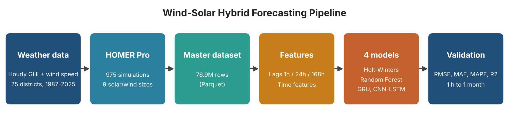
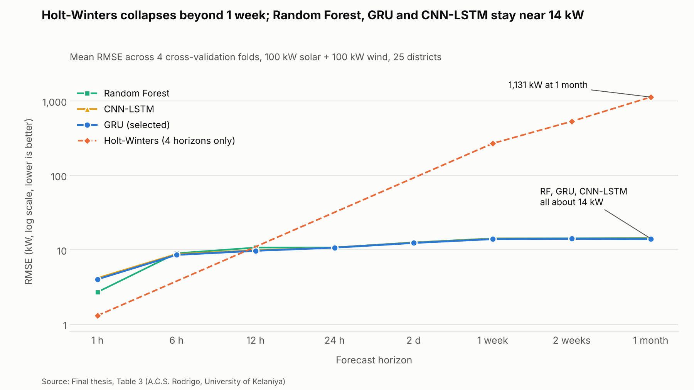

# Wind-Solar Hybrid Generation Forecasting for Sri Lanka

Statistical, machine learning and deep learning models for forecasting the power output of wind-solar hybrid systems across 25 districts of Sri Lanka, from **1 hour to 1 month ahead**.

Final-year capstone project (ETEC 43018), Bachelor of Engineering Technology Honours, University of Kelaniya.

**Author:** A.C.S. Rodrigo
**Supervisor:** Dr. Shakila Pathirana

---

## Why this project?

Wind and solar output changes with the weather, which makes grid scheduling and stability difficult. Hybrid systems smooth the combined output, but safe grid integration still depends on accurate generation forecasts.

Most studies forecast wind and solar separately, and validation across different climate zones and seasons is rarely reported. This project forecasts the **total hybrid output** directly and validates it across climate zones, seasons, weather conditions, system sizes and districts.

## Objectives

1. Collect real power generation data from a wind-solar hybrid system.
2. Simulate hybrid system performance under varying climatic and operational scenarios to build a supplementary dataset.
3. Develop a forecasting algorithm using statistical and machine learning techniques.
4. Validate the algorithm with performance metrics under different climatic and seasonal conditions.

## Pipeline



```
Hourly GHI + wind speed (25 districts, 1987-2025)
        -> HOMER Pro simulation (975 runs)
        -> 76.9M-row master dataset (Parquet)
        -> Feature engineering (lags, time features)
        -> 4 forecasting models
        -> Validation (RMSE, MAE, MAPE, R2)
```

## Data

| Item | Detail |
|---|---|
| Locations | 25 districts of Sri Lanka |
| Period | 1987 to 2025 (hourly) |
| System sizes | 3 solar sizes (1, 5, 100 kW) x 3 wind turbine sizes (10, 50, 100 kW) = 9 combinations |
| Size | 76,869,000 rows |
| Source | Hourly GHI and wind speed from Global Atlas, simulated with HOMER Pro |
| Train / test | Train: up to 2022. Test: 2023 to 2025 |

The full dataset is too large for GitHub, so only a small sample is included in `data/sample_data.csv`.

**Real-world check (Objective 1):** a laboratory Dolang wind-solar hybrid trainer (40 W PV, 50 W wind) was used to validate a matched HOMER simulation. Wind simulation error was 1.8% MAPE. Solar matched after applying a NOCT thermal correction.

## Models compared

| Family | Model | Notes |
|---|---|---|
| Statistical | Holt-Winters | Trend + 24 h seasonality, refit every 30 days |
| Machine learning | Random Forest | 200 trees, max depth 20, one model per horizon |
| Deep learning | GRU | 2 layers x 128 units, district embedding, multi-horizon outputs |
| Deep learning | CNN-LSTM | Conv1D layers feeding a 2-layer LSTM |

**Approach:** direct multi-horizon forecasting (each horizon is predicted directly, not step by step). Inputs are only past values (1 h, 24 h and 168 h lags of GHI, wind and power) plus time features, so there is no data leakage. Horizons: 1 hour, 1 week, 2 weeks, 1 month. Models were compared using 4-fold expanding-window cross-validation.

## Key results

- Holt-Winters is accurate at 1 hour but fails beyond 1 week.
- Random Forest, GRU and CNN-LSTM stay reasonably accurate at 1 month.
- **GRU** gave the best balance of accuracy and consistency.
- Total hybrid power R2: **0.991 at 1 hour, 0.744 at 1 month**.
- Solar R2: 0.995 -> 0.931. Wind R2: 0.986 -> 0.526. Long-term accuracy is limited mainly by wind.
- Sunny hours are easier to forecast than cloudy hours (1-month R2 0.80 vs 0.55).
- Systems with 100 kW solar reach 1-month R2 of 0.75 to 0.90. The smallest (1 kW solar) systems fall to 0.38 to 0.40.
- Central highland districts (Nuwara Eliya, Kandy, Ratnapura) are the easiest to forecast. Far-northern dry-zone districts (Jaffna, Kilinochchi, Mannar, Mullaitivu) are the hardest.



## Repository structure

```
.
├── README.md
├── requirements.txt
├── .gitignore
├── LICENSE
├── scripts/
│   ├── 01_restructure_dataset.py      # builds lag features and horizon targets
│   ├── 02_train_statistical_model.py  # Holt-Winters, rolling-origin evaluation
│   ├── 03_train_ml_model.py           # Random Forest, one model per horizon
│   ├── 04_evaluate_models.py          # RMSE, MAE, MAPE, R2
│   ├── 05_train_gru.py                # GRU
│   └── 06_train_cnn_lstm.py           # CNN-LSTM
├── demo/
│   └── demo_forecast.py               # quick forecast on the sample data
├── data/
│   └── sample_data.csv
├── results/
│   └── (charts and validation tables)
└── images/
    └── (lab photo, pipeline diagram)
```

## How to run

```bash
# 1. Install packages
pip install -r requirements.txt

# 2. Quick demo on the sample data
python demo/demo_forecast.py
```

To reproduce the full training you need the full master dataset (not included). Generate it with HOMER Pro as described above, set `DATA_DIR` at the top of each script, then run the scripts in order from `01` to `06`.

## Limitations

- The dataset is **simulated** (HOMER Pro), so power output is a deterministic function of GHI and wind speed with no sensor noise or curtailment.
- No temperature or humidity effects and no battery storage are modelled.
- Early experiments used one configuration (100 kW solar + 100 kW wind) across all districts.
- The statistical model was run on a limited number of districts because of runtime.

## Future work

- Full SARIMA comparison
- Real measured data from operating plants
- Adding temperature and weather forecast inputs

## Acknowledgements

Thanks to Dr. Shakila Pathirana for supervision and guidance, and to the University of Kelaniya for the laboratory facilities.

## License

Released under the MIT License. See [LICENSE](LICENSE).
